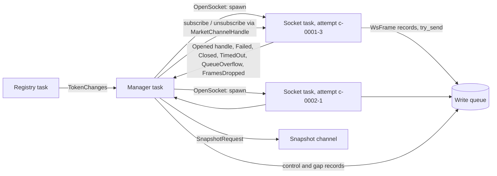

# Connection manager: handover notes

What was built on branch `claude/optimistic-galileo-uy0x7x`, how it works, and what was decided along the way. Section numbers refer to `design.md`; `implementation-status.md` has the project-wide picture.

Two commits:

| Commit | What it did |
| --- | --- |
| `ded99ab` | First version: token assignment, gap tracker, socket tasks, manager task, wiring into `run`. Used marcasite-core's raw websocket driver and kept the design's state machine (ping schedule, pong deadline, Subscribing state). |
| `eeb4db1` | Rewrite on `marcasite::ws::MarketChannel`, as you asked: marcasite owns heartbeat, idle timeout, connect timeout and the subscription messages. The state machine was cut down to match. |

This document describes the code as of `eeb4db1`.

## 1. What runs



| Piece | File | Job |
| --- | --- | --- |
| Manager task | `manager_task.rs` | The loop. Waits on, in priority order: cancellation, socket reports, registry `TokenChanges`, a 100 ms tick. Any error (only a closed write queue or snapshot channel) ends it; it always runs `shutdown` on the way out. |
| Manager | `manager.rs` | Holds the connections, the token assignment and the gap tracker. Steps a connection's state machine and carries out the actions it returns. The only code that starts or stops socket tasks or sends on a channel. |
| State machine | `connection.rs`, `types.rs` | Pure: `step(connection, event, now, config, rng) -> actions`. Section 2 below. |
| Token assignment | `assignment.rs` | Pure. Which slot carries each token. |
| Gap tracker | `gap_tracker.rs` | Pure. Turns `OpenGaps` / `CloseGaps` actions into matched `gap_open` / `gap_close` records. |
| Socket task | `socket.rs` | One per connection attempt. Connects a `MarketChannel`, then reads it and puts every event on the write queue. Does nothing else. |
| Fake server | `fake_server.rs` | Test only. A local websocket server the tests script. |

`archiver run` spawns the manager task next to the registry, supervised the same way (an error cancels everything and makes `run_stop` unclean). Until the writer and snapshot worker exist, `run` has two placeholder tasks that discard records and snapshot requests, so the queue never fills (marked `TODO` in `commands/run.rs`).

## 2. The state machine

### What marcasite owns now

| Concern | Before (design and first commit) | Now |
| --- | --- | --- |
| Subscription message | State machine sent it after the socket opened (Subscribing state, `SubscribeSent` event) | `MarketChannelBuilder::connect(subscription)` sends it during connect. The `OpenSocket` action carries the tokens. |
| Heartbeat | State machine scheduled `SendPing`, tracked `PongReceived` and a pong deadline | Channel sends `PING` every `heartbeat_interval` and drops `PONG`. |
| Dead connection | Pong deadline in the state machine | Channel's idle timeout (`heartbeat_timeout`) ends the stream with a `Timeout` error, which arrives as `SocketEvent::TimedOut`. |
| Connect timeout | Tick-driven timeout in Connecting and Subscribing | Channel's `connect_timeout` (handshake and subscription send). |
| Live subscribe and unsubscribe JSON | Hand-written serde structs | `MarketSubscriptionUpdate` through `MarketChannelHandle`. |
| Decoding messages | Not done (raw text archived) | Channel decodes every message into `MarketEvent`. See section 3. |

Per your instruction, nothing here tests or verifies marcasite's heartbeat or `PONG` handling.

### States

```mermaid
stateDiagram-v2
    [*] --> Connecting: Connection::new (OpenSocket with all tokens)
    Connecting --> Streaming: Opened
    Connecting --> Backoff: Failed, Closed, TimedOut, SendFailed, QueueOverflow
    Streaming --> Backoff: Closed, TimedOut, SendFailed, QueueOverflow
    Backoff --> Connecting: Tick after the wait (new attempt, OpenSocket)
    Connecting --> Closed: Shutdown, or last token removed
    Streaming --> Closed: Shutdown, or last token removed
    Backoff --> Closed: Shutdown, or last token removed
    Closed --> [*]
```

| State | Meaning | Ticks do |
| --- | --- | --- |
| `Connecting` | A socket task is connecting with the tokens from `OpenSocket` | Nothing (no timeout of its own) |
| `Streaming { since }` | The channel is open and subscribed | Nothing (`since` decides the backoff reset) |
| `Backoff { until }` | Waiting to reconnect | Start the next attempt once `until` has passed |
| `Closed` | Terminal; the manager drops the connection | Nothing |

### Events and actions

`SocketEvent` (from a socket task, tagged with its attempt ID; events from any other attempt are dropped):

| Event | Comes from | Effect |
| --- | --- | --- |
| `Opened` | Channel connected and subscribed | Connecting → Streaming. Emits `connect`, a `subscribe` snapshot request, `gap_close (resumed)` and a `subscribe` record for the tokens the socket subscribed to, then a live subscribe or unsubscribe for tokens that changed while connecting. |
| `Failed { error, retry_after }` | Connect failed | Backoff, gap reason `connect_failed`. The wait is at least `retry_after` (from a 429 or 503 handshake refusal). |
| `Closed { reason }` | Normal close, or a final error other than a timeout | Backoff, `connection_closed` |
| `TimedOut { error }` | Idle timeout or stalled write | Backoff, `heartbeat_timeout` |
| `SendFailed { error }` | A live subscribe or unsubscribe could not be sent | Backoff, `connection_closed` |
| `QueueOverflow` | The socket task dropped a record | Backoff, `queue_overflow` (forces fresh books) |

Other events: `Tick { last_message_at }`, `TokensAssigned`, `TokensRemoved`, `Shutdown`, unchanged from the design.

Actions: `OpenSocket { url, attempt_id, tokens }`, `CloseSocket`, `SendSubscribe`, `SendUnsubscribe`, `RequestSnapshot`, `OpenGaps`, `CloseGaps`, `Emit`. `SendPing` is gone.

### Rules kept from the design

- Two token sets: `assigned_tokens` (what we want) and `subscribed_tokens` (what the current socket subscribes to). Every attempt subscribes the full assigned set.
- Gaps open for every assigned token when entering backoff, starting at the last message received on that attempt (or now, if none). They close with `resumed` on the next `Opened`, `unsubscribed` when a token is removed, and `shutdown` at shutdown.
- `connect` is always followed by `disconnect` before the next `connect`; an attempt that never opened writes neither.
- Backoff: 1 s doubling to 60 s, plus 0–50% jitter, reset after 5 minutes of streaming.
- Token changes in any state: applied live only while Streaming; otherwise they go into the next subscription.

The randomised test (200 seeds × 2,000 random events) still checks the gap contract and connect/disconnect pairing over all states.

## 3. Decisions you may want to revisit

1. **The archive holds decoded events, not raw text.** This is the main consequence of using `MarketChannel`, which yields only typed `MarketEvent`s. The design (sections 4, 8.1) stores each frame's exact text. Now:
   - a frame holding a JSON array becomes one record per element;
   - unrecognised messages are kept as their JSON value (`MarketEvent::Unknown`);
   - recognised messages will be re-encoded from marcasite's typed fields when the writer serialises them, so undocumented fields are lost. Prices and sizes stay exact decimals (`rust_decimal`), never floating point.

   If byte-exact archiving matters, the cleanest fix is upstream: a marcasite option to hand over the raw text alongside each event.
2. **Undecodable messages.** A recognised message that fails marcasite's schema decode cannot be archived. The socket task writes a new control record, `ControlBody::FrameDecodeFailed { error }`, quoting marcasite's error, which includes the first 256 bytes of the message. It does not open a gap: the stream goes on, and the affected tokens can't be known for certain.
3. **Gap start granularity.** `last_message_at` is copied into the state machine on each 100 ms tick, so a gap can start up to one tick before the actual last message, never after it (conservative).
4. **`GapClose` carries `reason`** (was an `attempts` field), as the design specifies.
5. **Closing a gap that isn't open is silent**, not a warning as section 14.3 says, because connections close gaps on every resume and unsubscribe whether or not one was open.
6. **`tokens_per_connection` must be at least 2** (new config validation), so a market's two tokens always fit on one connection.
7. **Slot IDs are never reused.** An emptied connection closes and is forgotten; the next new slot gets the next number.
8. **`connect.token_count`** is the number of tokens the socket subscribed to, which can include a token removed while connecting (it is unsubscribed straight after).
9. **Control records wait for queue space** (`send().await`), while websocket events never wait (`try_send`, drop and count). A full queue can therefore stall the manager briefly, but never the socket tasks.

## 4. Not done

- **`awaiting_book`** (section 10): request a `missing_book` snapshot if a token gets no book within 2 minutes, then mark it unhealthy. Needs `BooksSeen` from the frame inspector and the snapshot worker. With typed events, the inspector is just a match on `MarketEvent::Book`, `MarketResolved` and `NewMarket`.
- **Write queue counters** (depth, high-water) for the status file.
- **The writer and snapshot worker**, which replace the placeholder consumers in `run`.

## 5. Tests

`just archiver test`: 122 tests, under 1 s. New or changed for this work:

| Module | Tests | Covers |
| --- | --- | --- |
| `connection` | 38 | Every transition above, `Retry-After`, timeout → `heartbeat_timeout`, token changes while connecting, stale events, shutdown from every state, the randomised contract test |
| `assignment` | 7 | The "Token assignment" table in 14.2 |
| `gap_tracker` | 4 | The "Gap tracker" table in 14.3 |
| `manager_task` | 7 | Against the fake server with shrunk timings: events recorded in order (typed, arrays split, unknown kept, undecodable → control record); server close (gap from last message, reconnect subscribes every token, live subscribe); refused connections are one gap; gaps closed at shutdown; unsubscribe and closing an empty connection; markets spread over connections; full write queue |
| `socket` | 1 | `last_message_at` microsecond round trip |

The manager tests passed 20 runs in a row. A 10 s run of `archiver run` against live Polymarket connected 78 tokens on one connection and shut down cleanly.

`just archiver lint` fails, as it did before this branch, on unused code waiting for the writer, inspector and status reporter, plus four `cli.rs` warnings. None of the failures are in `connection_manager/`.
