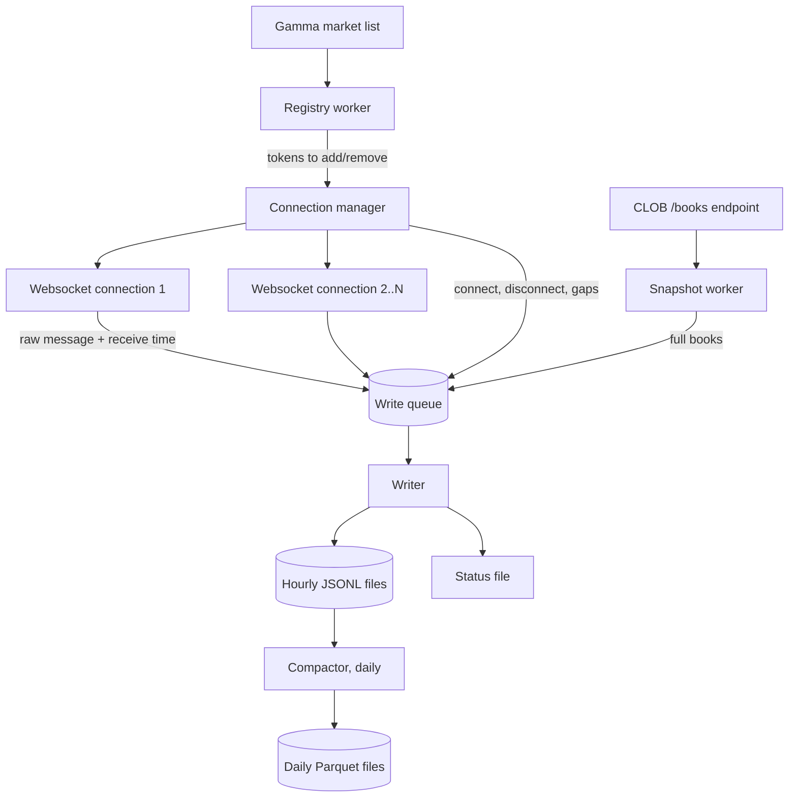
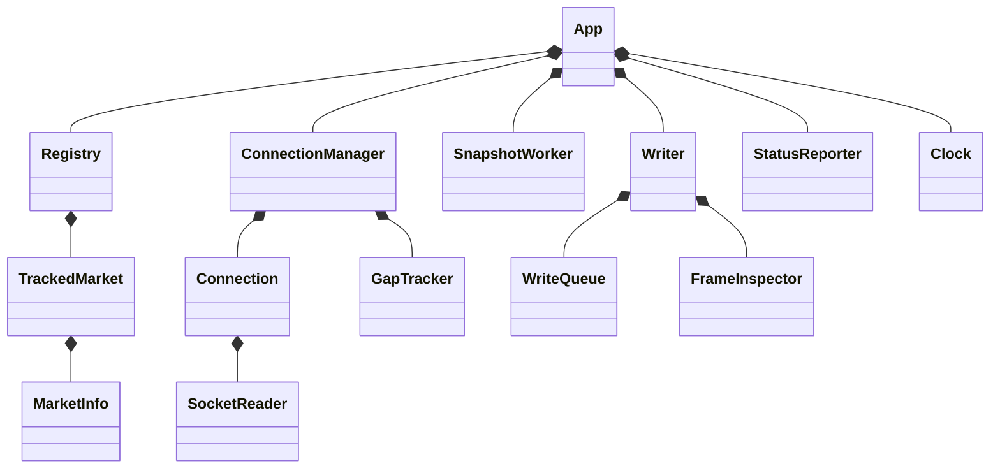
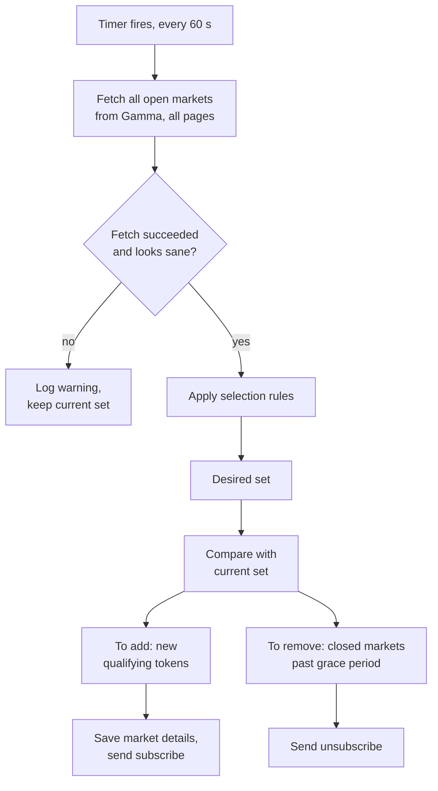
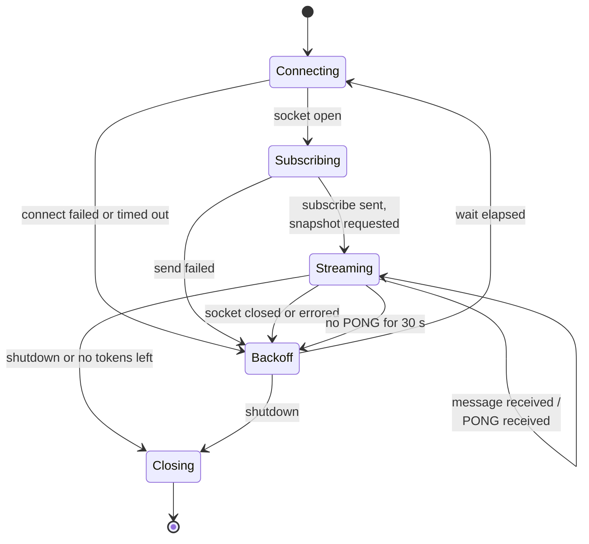
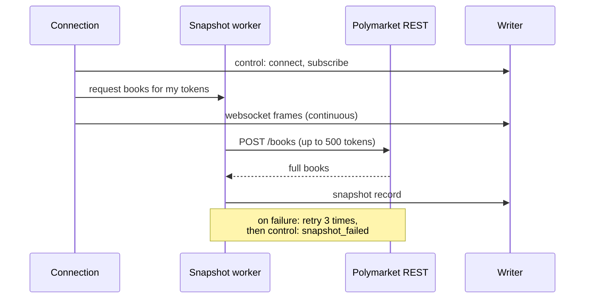
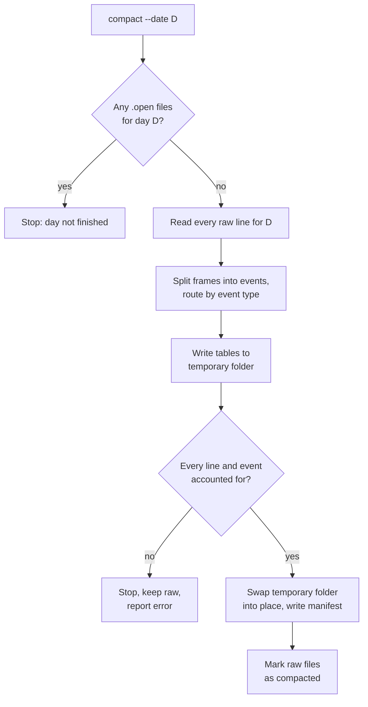

# Order Book Archiver Design
## 1. Purpose

The archiver is a long-running command-line program that records every order book change for a chosen set of Polymarket markets, and stores it so the order book can be rebuilt exactly, at any moment in the past.

Why it matters: Polymarket does not keep order book history, and it cannot be rebuilt from the blockchain. Paid archives only go back to around August 2025. The wider project (detecting informed trading and measuring whether following it pays after costs) depends on knowing what the book looked like when a trade happened. Every day this program is not running is history that is lost for good.

The module must achieve three things:

1. **Completeness:** capture every message the exchange sends for the tracked markets, with as few gaps as possible.
2. **Honesty about gaps:** where data was missed (disconnects, crashes, restarts), record exactly when and for how long, so later analysis can exclude those periods.
3. **Reliability over cleverness:** it runs unattended for months. It stores raw data and does no analysis. Anything that could crash it or slow it down belongs in a different program.

## 2. Scope

The archiver records and stores; it never interprets. If a feature needs to understand prices or trades, it belongs elsewhere.

| In scope | Out of scope |
| --- | --- |
| Choosing which markets to track (politics and geopolitics, above a liquidity floor) | Detecting anomalies, scoring trades, alerting |
| Recording every live order book message for those markets | Placing orders, holding keys, anything involving money |
| Taking regular full order book snapshots | Rebuilding books for analysis (a separate tool reads the archive) |
| Logging gaps, disconnects and restarts | Recording wallet-identified trades or blockchain data (other ingest modules) |
| Converting hourly raw files into compressed, columnar daily files | Databases, dashboards, web interfaces |
| A small command-line interface to run, check and verify the archive | Multiple machines, high availability, clustering |

## 3. Glossary

| Term | Meaning |
| --- | --- |
| Market | A single yes/no question on Polymarket, e.g. "Will X happen by date Y?". Identified by a condition ID. |
| Event | A group of related markets (e.g. several date variants of one question). |
| Token (asset) | One side of a market. Each market has two tokens: YES and NO. Order books exist per token, so the archiver subscribes by token ID. |
| Order book (book) | The list of all resting buy orders (bids) and sell orders (asks) for a token, grouped by price. |
| Bid / ask | A bid is an offer to buy at a price; an ask is an offer to sell. The best bid is the highest bid, the best ask the lowest ask. |
| Price level | One price on the book and the total size resting at it. |
| Snapshot | A complete copy of a book at one moment. |
| Delta (update) | A message describing a change to one or more price levels, not the whole book. Deltas only make sense applied on top of a snapshot. |
| Tick size | The smallest allowed price step for a token (e.g. 0.01 or 0.001). It can change during a market's life. |
| Websocket | A long-lived network connection where the server pushes messages to the client as they happen, instead of the client asking repeatedly. |
| REST call | An ordinary one-off web request ("give me X") that returns one response. |
| CLOB | Central Limit Order Book: Polymarket's order matching service. Its websocket and REST endpoints are the main data sources here. |
| Gamma | Polymarket's market-information service: lists markets, their categories, token IDs, start and end dates. |
| Registry | The archiver's own list of which tokens it is currently tracking, rebuilt regularly from Gamma. |
| Envelope | The small wrapper the archiver adds around each received message (receive time, connection ID and so on) before writing it. |
| JSON Lines (JSONL) | A text file with one JSON object per line. Easy to append to; safe to read even if the last line was cut off by a crash. |
| Parquet | A compressed, column-oriented file format used for analysis. Efficient to read, but cannot be appended to once written. |
| Compaction | The daily job that converts finished JSONL files into Parquet. |
| Gap | A period during which the archiver may have missed messages for a token. |
| UTC | Coordinated Universal Time. All times in this program are UTC. |
| Monotonic clock | A clock that only moves forward and is not affected by system time adjustments. Used for measuring durations, never for timestamps written to disk. |

## 4. External data sources

The archiver uses three public Polymarket services. None need an account or API key.

| Source | Address | Used for | How often |
| --- | --- | --- | --- |
| Market websocket | `wss://ws-subscriptions-clob.polymarket.com/ws/market` | The live stream of book changes and trades. The main data. | Continuously |
| Book snapshot endpoint | CLOB REST: `POST /books` (up to 500 tokens per request) | Full order books, taken on a timer and after every reconnect | Hourly, plus on demand |
| Market list | Gamma REST: `GET /markets` | Deciding which tokens to track | Every 60 seconds |

The websocket sends these message types (field names as they appear on the wire, see [market channel docs](https://docs.polymarket.com/market-data/websocket/market-channel)):

| `event_type` | What it means | Key fields |
| --- | --- | --- |
| `book` | Full order book for one token | `asset_id`, `market`, `bids[]`, `asks[]`, `hash`, `timestamp` |
| `price_change` | One or more price levels changed | `market`, `price_changes[]` (each with `asset_id`, `price`, `size`, `side`, `hash`, `best_bid`, `best_ask`), `timestamp` |
| `last_trade_price` | A trade happened | `asset_id`, `price`, `size`, `side`, `fee_rate_bps`, `transaction_hash`, `timestamp` |
| `tick_size_change` | Minimum price step changed | `asset_id`, `old_tick_size`, `new_tick_size`, `timestamp` |
| `best_bid_ask`, `new_market`, `market_resolved` | Extra messages, only sent when the subscription sets `custom_feature_enabled: true` | See docs |

Things a developer must know about this stream:

- **Prices and sizes arrive as strings** (e.g. `"0.08"`). Store them as strings. Never convert to floating-point numbers in the archiver; rounding errors would corrupt the record.
- **Exchange timestamps are milliseconds since 1 January 1970, sent as strings.** Store them unchanged, next to your own receive time.
- **There is no message sequence number.** You cannot tell from the stream alone that a message was dropped. This is why snapshots and the gap log exist (sections 9 and 10).
- **A single `price_change` can cover several tokens.** Do not assume one message equals one token.
- **Heartbeat:** send the text `PING` every 10 seconds; the server replies `PONG`. No reply means the connection is dead even if it looks open.
- **Tokens can be added or removed on a live connection** by sending `{"assets_ids":[...],"operation":"subscribe"}` or `"unsubscribe"`.
- **Enable `custom_feature_enabled`.** The `new_market` and `market_resolved` messages are useful early warnings for the registry, and recording them costs nothing.

## 5. Architecture and object model

The program is one process with a few independent workers that talk only through in-memory queues and shared state. The single most important rule: **the code that reads from the websocket does nothing except stamp the time and hand the message on.** Slow work (disk, network calls, parsing) must never delay reading the socket.

### 5.1 Components



The arrows show data flow. Gamma and the `/books` endpoint are external; everything else is part of the program.

| Component | Responsibility | Must never |
| --- | --- | --- |
| Registry worker | Every 60 s, fetch the market list, decide which tokens to track, and tell the connection manager what changed | Block the websocket readers; drop all tokens because one Gamma request failed |
| Connection manager | Owns the websocket connections; splits tokens across them; reconnects; subscribes and unsubscribes | Hold more than a configured number of tokens on one connection |
| Websocket connection | Read messages, attach receive time and connection ID, push to the write queue; send heartbeats | Parse, validate or write to disk |
| Snapshot worker | Fetch full books on a timer and when asked after a reconnect | Retry so aggressively it hits rate limits |
| Write queue | A bounded in-memory buffer between producers and the writer | Grow without limit (see section 10 for what happens when it is full) |
| Writer | The only component that touches the raw files; appends, rotates hourly, flushes | Be bypassed by any other component writing files directly |
| Compactor | Converts finished hourly files into daily Parquet; runs as a separate command | Touch the file currently being written |
| Status file | A small file rewritten every few seconds with counters and health, read by the `status` command | Contain anything needed to rebuild data |

**Why several connections instead of one?** One connection carrying thousands of tokens means one network blip loses data for everything. Splitting tokens across connections (default 250 tokens per connection) limits the damage from any single failure and keeps subscription messages small.

### 5.2 Notation and basic value types

The object descriptions below use a neutral notation that maps onto any mainstream language:

| Notation | Meaning | Typical equivalents |
| --- | --- | --- |
| `Name { field: Type, ... }` | A record or class with named fields | struct, class, record, data class |
| `A \| B \| C` | Exactly one of several named cases (a tagged union), each case possibly carrying its own fields | enum with data, sealed class, sum type, or a `kind` field plus optional fields |
| `List<T>`, `Set<T>`, `Map<K, V>` | Ordered list, collection without duplicates, lookup table | array/vector, set, dictionary/hash map |
| `Optional<T>` | A value that may be absent | nullable, option, maybe |
| `SortedMap<K, V>` | Lookup table kept in key order | tree map, ordered dictionary |

**Basic value types.** Give each of these its own named type, even where the language would let you use a plain string or number. Mixing up a token ID and a condition ID, or milliseconds and microseconds, is an easy mistake that compiles fine and corrupts data silently; distinct types turn it into an error the compiler or linter catches.

| Type | Underlying form | Example | Notes |
| --- | --- | --- | --- |
| `TokenId` | string | `"7132...9046"` | Very long decimal number. Keep as a string: it overflows 64-bit integers |
| `ConditionId` | string | `"0x74b3...c1e2"` | Hexadecimal market identifier |
| `RunId` | string | `"r-20260925-1400-a1b2"` | Created once per process start; date, time and a random suffix |
| `ConnSlotId` | string | `"c-0003"` | Identifies a connection *slot*, stable across reconnects |
| `ConnAttemptId` | string | `"c-0003-7"` | Slot plus attempt number; new for every connection attempt. This is the `conn_id` in the envelope |
| `DecimalString` | string | `"0.08"` | A price or size exactly as the exchange sent it. Never converted to floating point inside the archiver |
| `UtcMicros` | 64-bit integer | `1790348400123456` | Wall-clock time, microseconds since 1 January 1970 UTC. Used for everything written to disk |
| `MonoTime` | whatever the language's monotonic clock returns |  | Used only for timers and durations; never written to disk |
| `ExchangeMillisString` | string | `"1790348400120"` | Exchange timestamp as received |
| `Seq` | 64-bit integer | `88213` | Per-process record counter |

### 5.3 Tasks, ownership and object relationships

The program runs as a small number of independent **tasks** (threads, lightweight tasks or event loops, depending on the language). Each piece of mutable state is owned by exactly one task, and only that task changes it. Other tasks communicate by sending messages to the owner's **inbox**, a thread-safe queue. This avoids locks almost entirely and means each component can be reasoned about, and tested, on its own.



A filled diamond (`*--`) means "owns": the object on the left creates the one on the right and controls its lifetime.

| Task | Owns (only it may change these) | Receives messages from | Sends messages to |
| --- | --- | --- | --- |
| App (main) | Startup recovery, shutdown sequence, the `RunId` | Operating system stop signal | Every task: `Shutdown` |
| Registry | `Registry` state: tracked markets, last accepted count | Timer; `FrameInspector` (market resolved, new market) | Connection manager: `TokenChanges`; write queue: market records |
| Connection manager | All `Connection` state machines, token-to-slot assignment, `GapTracker` | Socket readers, registry, snapshot worker, writer, timer | Snapshot worker: `SnapshotRequest`; write queue: control records |
| Socket reader (one per connection) | Nothing except its socket's read side | The socket | Write queue: frames; connection manager: `PongReceived`, `SocketClosed` |
| Snapshot worker | Pending snapshot set, schedule, rate limiter | Connection manager, timer, `snapshot` command | Write queue: snapshot records; connection manager: `BooksSeen` |
| Writer | Open files, `Seq` counter, flush and sync timers | Write queue | Registry and connection manager, via `FrameInspector` |
| Status reporter | The status file | Timer; reads counters published by the others | Nothing (writes the file) |

**The fast path, step by step.** A socket reader receives a frame, reads the wall clock, builds a `WsFrameRecord`, and tries to put it on the write queue. It also updates its connection's "last message received" time, a single value other tasks may read but only this reader writes. That is all it does. If the queue is full, it drops the frame, increments a drop counter, and sends `QueueOverflow` to the connection manager.

**Why the writer inspects frames.** A few features need to know what is inside a frame: the registry wants `market_resolved` and `new_market`, and the connection manager wants to know when a full `book` has arrived for each token (section 10). Doing this in the socket reader would slow the fast path, so the writer does it *after* the frame is safely written, using a `FrameInspector` that only looks for those three event types. If inspection fails on a strange frame, it logs and moves on; it can never stop a frame being written.

### 5.4 Market and registry objects

```text
MarketInfo {
  condition_id:    ConditionId
  question:        string
  slug:            string                 // short name used in the website address
  event_id:        Optional<string>       // groups related markets
  tags:            List<string>
  yes_token:       TokenId
  no_token:        TokenId
  start_date:      Optional<UtcMicros>
  end_date:        Optional<UtcMicros>
  active:          bool
  closed:          bool
  liquidity_usd:   DecimalString
  tick_size:       DecimalString
  neg_risk:        bool                   // part of a multi-outcome group
  fetched_at:      UtcMicros
}

TrackedMarket {
  info:            MarketInfo             // latest version seen
  added_at:        UtcMicros
  status:          Tracking
                 | Closing { grace_until: UtcMicros, cause: ClosedOnGamma | ResolvedOnWebsocket }
}

Registry {
  markets:              Map<ConditionId, TrackedMarket>
  last_accepted_count:  int              // for the "fewer than half" sanity check
  last_success_at:      Optional<UtcMicros>
}
```

**Operations** (pure functions; the registry task calls them and acts on the result):

| Operation | Input | Output |
| --- | --- | --- |
| `parse_gamma_page` | Raw response text | `List<MarketInfo>` plus a list of skipped markets with reasons |
| `select` | `List<MarketInfo>`, config | Markets that meet the *joining* rules |
| `sanity_check` | Fetched count, `last_accepted_count` | Accept, or Reject with a reason |
| `plan_changes` | `Registry`, selected markets, resolved notices, now | `RegistryPlan { add: List<MarketInfo>, remove: List<ConditionId>, details_changed: List<MarketInfo>, new_registry: Registry }` |

`plan_changes` applies the "stay tracked" rules from section 6: a tracked market that no longer meets the joining rules is kept; a closed or resolved market moves to `Closing`; a `Closing` market whose `grace_until` has passed goes on the `remove` list.

"Details changed" compares only fields that matter for later analysis (question, dates, tags, tick size, token IDs), not `liquidity_usd` or `fetched_at`, which change constantly and would flood the `markets/` folder.

### 5.5 Connection objects

The connection state machine from section 7 is written as data plus one pure function. The `Connection` record holds everything the machine knows; `ConnEvent` is everything that can happen to it; `ConnAction` is everything it can ask the outside world to do.

```text
Connection {
  slot_id:            ConnSlotId
  attempt_id:         Optional<ConnAttemptId>   // absent before the first attempt
  attempt_count:      int                        // drives backoff; reset after stable streaming
  state:              ConnState
  assigned_tokens:    Set<TokenId>               // what we WANT subscribed
  subscribed_tokens:  Set<TokenId>               // what the server has been TOLD
  last_message_at:    Optional<UtcMicros>        // written by the socket reader only
  last_pong_at:       Optional<MonoTime>
  last_ping_at:       Optional<MonoTime>
}

ConnState =
    Connecting  { started_at: MonoTime }
  | Subscribing
  | Streaming   { since: MonoTime }
  | Backoff     { until: MonoTime }
  | Closing
  | Closed
```

**Why two token sets?** `assigned_tokens` changes whenever the registry says so, at any time. `subscribed_tokens` only changes when a subscribe or unsubscribe message is actually sent. The difference between them is exactly the work still to do. On every reconnect, `subscribed_tokens` is cleared and the full `assigned_tokens` set is sent. This is what guarantees that no change is lost during a reconnect.

```text
ConnEvent =
    SocketOpened
  | SocketFailed      { error: string }             // could not connect
  | SocketClosed      { reason: string }            // was connected, now closed
  | SendFailed        { error: string }
  | PongReceived      { at: MonoTime }
  | Tick              { now: MonoTime, wall: UtcMicros }  // regular timer, e.g. every 100 ms
  | TokensAssigned    { tokens: Set<TokenId> }
  | TokensRemoved     { tokens: Set<TokenId> }
  | QueueOverflow                                    // this connection's frames were dropped
  | Shutdown

ConnAction =
    OpenSocket        { url: string, attempt_id: ConnAttemptId }
  | CloseSocket
  | SendSubscribe     { tokens: Set<TokenId>, custom_features: bool }
  | SendUnsubscribe   { tokens: Set<TokenId> }
  | SendPing
  | RequestSnapshot   { tokens: Set<TokenId>, reason: SnapshotReason }
  | OpenGaps          { tokens: Set<TokenId>, start: UtcMicros, reason: GapReason }
  | CloseGaps         { tokens: Set<TokenId>, end: UtcMicros, reason: GapReason }
  | Emit              { body: ControlBody }     // connect, disconnect, subscribe...
```

The core function is:

```text
step(connection: Connection, event: ConnEvent, config: Config)
    -> (Connection, List<ConnAction>)
```

The connection manager holds a `Map<ConnSlotId, Connection>`. Its loop is always the same: take the next event from its inbox, find the connection it belongs to, call `step`, store the new `Connection`, and carry out each action in order. Carrying out an action is the only place where sockets are touched.

**Connection manager's own state:**

```text
ConnectionManager {
  connections:     Map<ConnSlotId, Connection>
  token_slot:      Map<TokenId, ConnSlotId>       // which connection carries each token
  next_slot_no:    int
  gaps:            GapTracker                      // see 5.7
  awaiting_book:   Map<TokenId, UtcMicros>         // subscribed but no full book yet, since when
}
```

Its two assignment operations, `assign(markets) -> Map<ConnSlotId, Set<TokenId>>` and `unassign(condition_ids) -> Map<ConnSlotId, Set<TokenId>>`, are pure functions over `connections` and `token_slot`, implementing the rules in section 7 (least-loaded first, pairs kept together, no rebalancing). Their outputs become `TokensAssigned` and `TokensRemoved` events for the affected connections.

### 5.6 Records, queues and messages

Two kinds of thing move between tasks: **records**, which are going to disk, and **messages**, which ask another task to do something. Keep them as separate types so it is impossible to accidentally write a message to the archive, or send a record to a task inbox.

#### Records (go through the write queue to the writer)

```text
Record =
    WsFrameRecord       { recv_ts: UtcMicros, run_id: RunId, conn_id: ConnAttemptId, raw: string }
  | SnapshotRecord      { recv_ts: UtcMicros, run_id: RunId, requested_tokens: List<TokenId>,
                          reason: SnapshotReason, raw: string }
  | ControlRecord       { recv_ts: UtcMicros, run_id: RunId, conn_id: Optional<ConnAttemptId>,
                          body: ControlBody }
  | MarketRecord        { recv_ts: UtcMicros, run_id: RunId, market: MarketInfo, change: Added | Updated }
```

The writer adds `seq` when it writes each record, so the numbering matches the order on disk exactly. Producers never set it. The writer turns each record into the envelope in section 8.1.

```text
ControlBody =
    RunStart          { program_version: string, config_hash: string, previous_run: Optional<RunId> }
  | RunStop           { clean: bool }
  | Connect           { slot: ConnSlotId, token_count: int }
  | Disconnect        { slot: ConnSlotId, reason: string }
  | Subscribe         { slot: ConnSlotId, tokens: List<TokenId> }
  | Unsubscribe       { slot: ConnSlotId, tokens: List<TokenId> }
  | GapOpen           { tokens: List<TokenId>, start: UtcMicros, reason: GapReason }
  | GapClose          { tokens: List<TokenId>, end: UtcMicros, reason: GapReason }
  | SnapshotFailed    { tokens: List<TokenId>, error: string, attempts: int }
  | QueueOverflow     { slot: ConnSlotId, dropped: int }
  | RegistryRejected  { reason: string, fetched: int, previous: int }
  | TokenUnhealthy    { token: TokenId, since: UtcMicros }

GapReason =
    connect_failed | connection_closed | heartbeat_timeout | queue_overflow
  | process_restart | write_failure | shutdown | unsubscribed | resumed

SnapshotReason = subscribe | new_token | scheduled | manual | missing_book
```

`config_hash` is a short fingerprint of the active configuration, so later analysis can tell whether settings changed between runs.

#### The write queue

```text
WriteQueue {
  capacity:    int                 // from config, default 100,000
  try_put(record) -> Accepted | Full   // never waits
  take() -> Record                     // waits until a record is available
  depth() -> int
  high_water() -> int                  // highest depth since last reset
}
```

`try_put` must never wait: that is what protects the socket readers. `take` is only ever called by the writer.

#### Messages (go to a task's inbox)

```text
ManagerMsg =
    ForConnection     { slot: ConnSlotId, event: ConnEvent }
  | TokenChanges      { add: List<MarketInfo>, remove: List<ConditionId> }
  | BooksSeen         { tokens: Set<TokenId>, at: UtcMicros }     // from inspector or snapshot worker
  | Tick              { now: MonoTime, wall: UtcMicros }
  | Shutdown

RegistryMsg =
    MarketResolved    { condition_id: ConditionId, at: UtcMicros }
  | NewMarketSeen     { condition_id: ConditionId }                // triggers an early refresh
  | Shutdown

SnapshotMsg =
    SnapshotRequest   { tokens: Set<TokenId>, reason: SnapshotReason }
  | TokensTracked     { add: Set<TokenId>, remove: Set<TokenId> } // keeps the hourly schedule current
  | Shutdown
```

Inboxes can be unbounded: they carry a handful of messages per second at most. Only the write queue carries market data volume, and only it needs a limit.

**Shared values that are not messages.** Two things are written by one task and read by others, too often to send as messages: each connection's `last_message_at` (written by its socket reader) and the counters used by the status reporter (messages received, frames dropped, and so on). Store each as a single atomic value (a number that can be safely read and written from different threads without a lock). Exactly one task writes each; any task may read. The connection manager copies `last_message_at` into its `Connection` record on every `Tick`.

### 5.7 Supporting objects

#### Clock

```text
Clock (interface) {
  wall_now() -> UtcMicros
  mono_now() -> MonoTime
  sleep_until(t: MonoTime)          // or the language's timer equivalent
}
```

Two implementations: `SystemClock` for production and `FakeClock` for tests (section 14.1). Every task receives the clock when it is created; nothing else may read the time.

#### Config and backoff

`Config` is a plain record with one field per setting in section 12.2, loaded and checked once at startup, then passed to every task. It never changes while the program is running.

```text
backoff_delay(attempt: int, config: Config, random: RandomSource) -> Duration
```

`RandomSource` is passed in rather than created inside, so tests can fix the jitter.

#### Gap tracker (owned by the connection manager)

```text
GapTracker {
  open_gaps: Map<TokenId, OpenGap>

  open(tokens, start, reason)  -> Optional<ControlBody.GapOpen>   // only tokens not already open
  close(tokens, end, reason)   -> Optional<ControlBody.GapClose>  // only tokens actually open
  open_count() -> int
}

OpenGap { start: UtcMicros, reason: GapReason }
```

Both operations ignore tokens already in the requested state, which is what makes "double open" and "close without open" harmless (section 14.3). They return the control record to write, or nothing if no token changed.

#### Snapshot worker

```text
SnapshotWorker {
  pending:      List<TokenId>                    // waiting, first-in first-out, no duplicates
  reasons:      Map<TokenId, SnapshotReason>
  schedule:     Map<TokenId, UtcMicros>          // next scheduled snapshot per tracked token
  limiter:      RateLimiter
  in_flight:    Optional<{ tokens: List<TokenId>, attempts: int }>   // batch being requested now
}

RateLimiter {
  capacity:       int           // maximum burst
  refill_per_s:   number        // from snapshot_max_requests_per_s
  tokens:         number
  last_refill:    MonoTime
  try_acquire(now) -> bool
}
```

The rate limiter is a "token bucket": it holds up to `capacity` permits, gains `refill_per_s` permits per second, and each request spends one. (These permits are unrelated to market tokens; the name is standard.) When a token is first tracked, give it a scheduled time spread across the hour, e.g. its position in the tracked list times (3,600 s ÷ number of tokens), so snapshots don't bunch up.

#### Writer

```text
Writer {
  run_id:        RunId
  next_seq:      Seq
  files:         Map<FileKey, OutputFile>
  last_flush:    MonoTime
  last_sync:     MonoTime
  inspector:     FrameInspector
}

FileKey    { stream: ws | snapshots | control | markets, date: string, hour: Optional<int> }
OutputFile { open_path: string, final_path: string, handle: file handle, lines: int, bytes: int }
```

For every record taken from the queue: compute its `FileKey` from `recv_ts` (always UTC), open the file if needed, assign `seq`, serialise to one line, append. On a timer: flush, sync, and close and rename any file whose hour has ended. Control and market files are split by date only, so `hour` is absent for them.

Serialisation per record type: frames and snapshots carry `raw`; snapshots additionally carry `requested_tokens` and `reason`; control and market records carry their fields in place of `raw`. Every line has the common envelope fields from section 8.1.

#### Frame inspector (inside the writer)

```text
FrameInspector {
  inspect(raw: string, recv_ts: UtcMicros) -> List<Notice>
}

Notice = BookSeen { token } | MarketResolved { condition_id } | NewMarketSeen { condition_id }
```

First do a cheap text search for the three `event_type` values; only frames that match are fully parsed. `BookSeen` notices are batched and sent to the connection manager as `BooksSeen`; the others go to the registry.

#### Status reporter and the status file

Every 5 s the status reporter reads the shared counters, asks the connection manager for a small summary, and writes the file below (write to a temporary name, then rename).

```json
{
  "run_id": "r-20260925-1400-a1b2",
  "started_at": 1790344800000000,
  "written_at": 1790348400000000,
  "clean_stop": false,
  "last_message_at": 1790348399871234,
  "tokens_tracked": 1284,
  "connections": [
    { "slot": "c-0001", "state": "Streaming", "tokens": 250, "last_pong_age_s": 3.2 }
  ],
  "messages_last_minute": 5412,
  "queue": { "depth": 12, "high_water": 340, "capacity": 100000, "dropped_last_hour": 0 },
  "open_gaps": 0,
  "tokens_unhealthy": [],
  "snapshots_last_hour": 1284,
  "disk_free_gb": 181.4,
  "current_files": ["raw/ws/date=2026-09-25/hour=15/r-20260925-1400-a1b2.jsonl.open"],
  "last_compaction": { "date": "2026-09-24", "result": "ok" },
  "previously_tracked_tokens_file": "state/tracked_tokens.json"
}
```

The list of tracked tokens is kept in a separate `state/tracked_tokens.json`, rewritten whenever the tracked set changes, because it can be large. Startup recovery (section 7) reads both files to know which tokens to mark with a `process_restart` gap.

### 5.8 Offline objects (compaction and verification)

These are used only by the `compact`, `verify` and `gaps` commands, never by `run`. Unlike the archiver, they *do* parse prices, so they use a proper fixed-point decimal type (called `Decimal` below) instead of `DecimalString`.

#### Parsed events

The compactor turns each raw frame into zero or more events, one per table row:

```text
ParsedEvent =
    BookEvent          { asset_id: TokenId, market: ConditionId, bids: List<Level>, asks: List<Level>,
                         hash: string, exchange_ts: UtcMicros, source: websocket | snapshot }
  | PriceChangeEvent   { asset_id: TokenId, market: ConditionId, side: BUY | SELL, price: Decimal,
                         size: Decimal, best_bid: Optional<Decimal>, best_ask: Optional<Decimal>,
                         hash: string, exchange_ts: UtcMicros }
  | TradeEvent         { asset_id: TokenId, price: Decimal, size: Decimal, side: BUY | SELL,
                         fee_rate_bps: int, transaction_hash: string, exchange_ts: UtcMicros }
  | TickSizeEvent      { asset_id: TokenId, old_tick: Decimal, new_tick: Decimal, exchange_ts: UtcMicros }
  | LifecycleEvent     { kind: new_market | market_resolved, market: ConditionId, detail: string }
  | UnparsedEvent      { error: string, raw: string }

Level { price: Decimal, size: Decimal }
```

Every event also carries the frame's `recv_ts`, `seq`, `run_id` and `conn_id`, so any row can be traced back to its raw line. `parse_frame(raw) -> List<ParsedEvent>` is a pure function and the main target of the compactor unit tests. It must never throw: anything it cannot understand becomes an `UnparsedEvent`.

#### Order book (used by `verify` and later analysis)

```text
OrderBook {
  token:        TokenId
  bids:         SortedMap<Decimal, Decimal>   // price -> size, highest price first
  asks:         SortedMap<Decimal, Decimal>   // price -> size, lowest price first
  as_of:        UtcMicros                     // exchange time of the last applied event
  tick_size:    Decimal

  from_book(event: BookEvent) -> OrderBook
  apply(event: PriceChangeEvent) -> OrderBook  // size 0 removes the level
  equals(other: OrderBook) -> bool             // compares levels only
  best_bid() -> Optional<Level>
  best_ask() -> Optional<Level>
}
```

`apply` returns a new book rather than changing the old one. That makes it easy to keep the book at several moments and to compare them in tests.

#### Manifest and verification report

```text
DayManifest {
  date:              string                    // YYYY-MM-DD
  program_version:   string
  compacted_at:      UtcMicros
  inputs:            List<{ path: string, lines: int, malformed_lines: int }>
  row_counts:        Map<string, int>          // table name -> rows
  accounting_ok:     bool
}

VerifyReport {
  date:            string
  tokens_checked:  int
  windows:         List<VerifyWindow>
}

VerifyWindow {
  token:    TokenId
  start:    UtcMicros          // anchor book time
  end:      UtcMicros          // comparison snapshot time
  result:   Match | Mismatch { differing_levels: int } | NotCheckable { reason: string }
}
```

`NotCheckable` covers windows that contain a recorded gap, or that have no anchor book, so they are reported honestly rather than silently skipped.

## 6. Market selection (the registry)

Every 60 seconds the registry works out the set of tokens that *should* be tracked, compares it with what *is* tracked, and sends only the difference to the connection manager. It is cautious by design: adding a market late loses a little data, but wrongly dropping hundreds of markets loses a lot.



**Selection rules** (all configurable):

1. The market carries at least one of the configured category tags (default: politics, geopolitics).
2. The market is active and accepting orders.
3. The market's 24-hour volume or liquidity is above a floor (default: $1,000 liquidity). This keeps the set to a manageable size.
4. Both tokens of a market are always tracked together. Never track only YES or only NO.

**Rules for staying tracked** are deliberately looser than rules for joining:

- Once a token is tracked, it stays tracked until its market closes, even if its volume falls below the floor. Otherwise quiet markets flicker on and off, creating artificial gaps exactly when informed traders might act.
- After a market closes or resolves, keep it for a grace period (default 6 hours) to capture final activity, then unsubscribe.
- A `market_resolved` message on the websocket starts the grace period immediately, without waiting for Gamma.

**Sanity check before acting.** If the Gamma request fails, times out, or returns fewer than half as many qualifying markets as last time, treat it as a bad response: log a warning, change nothing, and try again next cycle. An outage at Gamma must never cause mass unsubscribing.

**Save market details.** Whenever a market is added, or its details change, write a record (condition ID, both token IDs and which is YES, question text, tags, start and end dates, tick size, time recorded) to the archive's `markets/` folder. Later analysis needs this to know what each token ID means, and markets can be edited or removed from Gamma after the fact.

## 7. Websocket connection lifecycle

Each connection is a small state machine. It always knows which tokens it *should* be subscribed to (its assigned set, owned by the connection manager) and repairs itself towards that on every reconnect. A connection that is not streaming is, by definition, a gap for all its tokens.



| State | What happens | Leaves when |
| --- | --- | --- |
| Connecting | Open the socket. A new connection ID is created for every attempt. Timeout 10 s. | Socket opens, or fails / times out |
| Subscribing | Send one subscribe message with the whole assigned token set and `custom_feature_enabled: true`. Ask the snapshot worker for fresh books for all these tokens. Close any open gap records for them, using the current time as the gap end. | Send succeeds or fails |
| Streaming | Read messages and push them to the write queue. Send `PING` every 10 s. Apply live token additions and removals. | Socket closes, errors, heartbeat fails, or shutdown |
| Backoff | Open a gap record for every assigned token, starting at the time of the last message received on this connection. Wait, then reconnect. | Wait elapses, or shutdown |
| Closing | Send unsubscribe if possible, close the socket, record a clean stop. | Done |

**Heartbeat and liveness.** Track the time of the last `PONG`. If none has arrived for 30 s, assume the connection is dead, even if the socket looks open. Do *not* use "no messages received" as a liveness test: a quiet market can legitimately send nothing for hours.

**Backoff timing.** Wait 1 s after the first failure, then double each time (2, 4, 8 …) up to 60 s. Add jitter: a random extra 0–50% of the wait. Jitter stops all connections from reconnecting at exactly the same instant after a shared outage, which could otherwise trigger rate limits. Reset the wait to 1 s once a connection has streamed for 5 minutes.

**Token changes while not streaming.** The connection manager updates the assigned set at any time. If the connection is streaming, it also sends a live subscribe or unsubscribe. If not, nothing is sent; the next Subscribing state uses the updated set. This means no token change is ever lost during a reconnect.

**Assigning tokens to connections.** New tokens go to the connection with the fewest tokens, as long as it is below the per-connection limit (default 250); otherwise open a new connection. Both tokens of one market go on the same connection, so a failure affects whole markets, never half of one. Do not rebalance existing tokens between connections; moving a token creates a small gap for no benefit.

**Startup and crash recovery.** On startup, read the status file from the previous run. If it did not record a clean stop, write a gap record covering every previously tracked token, from the last message time in that file to now, with reason `process_restart`.

## 8. Recording format and file layout

Every websocket frame is written exactly as received, inside a small envelope, as one line of a JSON Lines file. The archiver never rewrites, reorders or "cleans" exchange data. If the exchange changes its message format, old and new files simply contain different raw text, and the reader deals with it later.

### 8.1 The envelope

| Field | Type | Meaning |
| --- | --- | --- |
| `recv_ts` | integer, microseconds since 1 January 1970, UTC | When this program received the frame, from the system clock |
| `seq` | integer | A counter that increases by one for every record this process writes. Gives a total order and lets you detect lost lines |
| `run_id` | string | Unique ID created at process start |
| `conn_id` | string | Unique ID of the connection attempt that received the frame (empty for snapshots) |
| `source` | `ws`, `snapshot` or `control` | Where the record came from |
| `raw` | string | The frame's exact text, unparsed |

Example line (shortened):

```json
{"recv_ts":1790348400123456,"seq":88213,"run_id":"r-20260925-1400-a1b2","conn_id":"c-0003-7","source":"ws","raw":"{\"event_type\":\"price_change\",\"market\":\"0x74...\",...}"}
```

Key points:

- **Store the whole frame, not individual events.** A frame may contain several events (the initial subscription reply often contains many books in one array). Splitting belongs to the compactor.
- **`PONG` replies are not recorded.** Count them in the status file instead.
- **Clock:** `recv_ts` comes from the system clock, which must be kept accurate by the operating system's time sync service (Network Time Protocol). All durations and timers use the monotonic clock instead, so a clock correction can't break heartbeats or backoff.

### 8.2 Control records

Everything that is not exchange data goes to a separate control stream with the same envelope, where `raw` is replaced by structured fields: `kind` plus details. Kinds: `run_start`, `run_stop`, `connect`, `disconnect` (with reason), `subscribe`, `unsubscribe` (with token lists), `gap_open`, `gap_close` (with token list, start, end, reason), `snapshot_failed`, `queue_overflow`, `registry_rejected`. This stream is what later analysis uses to decide which periods to trust.

### 8.3 Folder layout

```text
archive/
  raw/
    ws/date=2026-09-25/hour=14/r-20260925-1400-a1b2.jsonl
    snapshots/date=2026-09-25/hour=14/r-20260925-1400-a1b2.jsonl
  control/date=2026-09-25/r-20260925-1400-a1b2.jsonl
  markets/date=2026-09-25/r-20260925-1400-a1b2.jsonl
  parquet/            (written by the compactor, section 11)
  state/status.json
```

- Folders are split by UTC date and hour. The `name=value` folder style is understood automatically by most analysis tools.
- **File names include the run ID,** so two runs (e.g. after a restart within the same hour) never write to the same file.
- **A file being written ends in `.jsonl.open`.** At rotation it is flushed, synced to disk and renamed to `.jsonl`. The compactor only ever reads files without `.open`. This one rule removes a whole class of "read a half-written file" bugs.

### 8.4 Writing and durability

- One writer owns all files. Other components only put records on the write queue.
- Rotate at the start of every UTC hour.
- Flush to the operating system at least once a second, and force to disk (sync) at least every 5 seconds and on every rotation. A crash then loses at most about 5 seconds, which the startup gap record (section 7) covers.
- After a crash, the last line of a `.open` file may be cut off. On startup, rename leftover `.open` files to `.jsonl`; readers must skip a final line that is not valid JSON, and count it.
- If the disk is full or a write fails, log loudly, record a gap for everything, and exit with an error so the process supervisor restarts it. Do not keep running while silently losing data.

## 9. Snapshots

A full order book is recorded for every tracked token at least once an hour and immediately after any subscription starts. Deltas only make sense on top of a known starting book, so snapshots are the anchor points that make the archive rebuildable, and the way to recover after a gap.

**When a snapshot is taken:**

| Trigger | Tokens covered |
| --- | --- |
| A connection enters Subscribing (first start or reconnect) | All tokens on that connection |
| A token is newly added by the registry | That token (and its sibling) |
| Scheduled timer | Every tracked token, once per hour, spread evenly across the hour rather than all at once |
| The `snapshot` command (manual) | Whatever the operator asks for |

The websocket also sends full `book` messages, usually right after subscribing. Those are recorded as normal websocket data and count as anchor points too. The REST snapshot is a second, independent source, not a replacement.

**How it works:** the snapshot worker keeps a queue of token IDs waiting for a snapshot, removing duplicates. It takes up to 500 tokens at a time, calls `POST /books`, and writes the whole response as one record with `source: snapshot`. It limits itself to a configurable request rate (default 2 requests per second), well under the published limits.



The websocket stream and the snapshot run at the same time, so frames will be written both before and after the snapshot. That is expected. Each book carries its own exchange `timestamp` and `hash`, which lets the later rebuild step line them up with the deltas.

**On failure:** retry up to 3 times with backoff. If it still fails, write a `snapshot_failed` control record listing the tokens, and put them back in the queue for the next scheduled round. Never block the websocket or the writer while waiting.

## 10. Gaps and data integrity

Gaps will happen; the requirement is that every gap is recorded, so that nobody later analyses a book that was silently wrong. A token's data is trustworthy from the first full book received after it was subscribed, until the next `gap_open` for that token.

**Known causes of gaps, and how each is handled:**

| Cause | Detected by | Response |
| --- | --- | --- |
| Connection closed or errored | Socket error or close event | `gap_open` for the connection's tokens, reconnect (section 7) |
| Connection silently dead | No `PONG` for 30 s | As above, reason `heartbeat_timeout` |
| Process crashed or host rebooted | No clean stop in the previous status file | `gap_open` + `gap_close` on startup, reason `process_restart` |
| Write queue full | Queue at capacity when a frame arrives | Drop the frame, count it, `gap_open` for that connection's tokens (reason `queue_overflow`), and force that connection to reconnect so it gets fresh books |
| Disk write failed | Error from the file system | `gap_open` for everything, exit with error, supervisor restarts |
| Subscribed token never gets data | No `book` for the token within 2 minutes of subscribing | Warning, request a REST snapshot; if still nothing, mark the token as unhealthy in the status file |
| Exchange silently drops a message | Cannot be detected live (no sequence numbers) | Found later by `verify` (below) |

**Gap records.** `gap_open` carries the tokens, the start time (the last message received on that connection, not the time the problem was noticed) and the reason. `gap_close` carries the time the stream resumed. The gap is only fully healed once a full book has been recorded afterwards; readers work this out by finding the first `book` or snapshot after the `gap_close`.

**Why drop frames when the queue is full rather than wait?** Waiting would stall the socket reader, the server would eventually disconnect, and the loss would be larger and harder to date. Dropping, recording, and reconnecting gives a small, clearly marked gap. In practice the queue should never fill; if it does, something is wrong with the disk and should be investigated.

**Duplicates are kept.** After a reconnect the exchange may resend recent data. The archiver records it as received and never removes duplicates; that is the reader's job.

**Offline check (the `verify` command).** For a chosen day, rebuild each token's book by applying deltas on top of each anchor book, and compare the result with the next snapshot. A mismatch means data was lost somewhere without a recorded gap. `verify` writes a report listing each mismatch with token and time window. Run it daily after compaction. It is the only way to catch drops by the exchange itself, and it will also expose bugs in the rebuild logic, which is useful in its own right.

## 11. Compaction to Parquet

Once a day, a separate command turns the previous UTC day's raw files into compressed Parquet tables that analysis tools can query quickly. Compaction must be lossless, repeatable and safe to re-run; the raw files remain the source of truth until it has succeeded.



**Output tables**, one folder each, split by `date=`:

| Table | One row per | Main columns |
| --- | --- | --- |
| `frames` | Raw websocket frame | The full envelope and raw text. Makes the Parquet copy lossless on its own |
| `books` | Price level of a full book (from websocket `book` or REST snapshot) | `book_id`, `source`, `recv_ts`, `exchange_ts`, `asset_id`, `market`, `side`, `price`, `size`, `hash` |
| `price_changes` | Changed price level | `recv_ts`, `exchange_ts`, `seq`, `asset_id`, `market`, `side`, `price`, `size`, `best_bid`, `best_ask`, `hash` |
| `trades` | `last_trade_price` event | `recv_ts`, `exchange_ts`, `asset_id`, `price`, `size`, `side`, `fee_rate_bps`, `transaction_hash` |
| `tick_sizes` | `tick_size_change` event | `asset_id`, old and new tick size, times |
| `lifecycle` | `new_market` / `market_resolved` event | market, tokens, outcome, times |
| `control` | Control record | kind, tokens, reason, start, end |
| `markets` | Market details record | as in section 6 |
| `unparsed` | Anything not recognised | envelope + raw text + error message |

Rules:

- **Prices and sizes are stored as fixed-point decimals**, never floating-point. Use enough decimal places for the smallest tick (0.001) and for sizes with six decimals.
- **Unknown or malformed events go to `unparsed`; they never stop compaction.** A new message type from the exchange should show up as a growing `unparsed` table, not a failed job.
- **Accounting check:** raw lines read = rows in `frames` + control rows + market rows + malformed lines. Events extracted = rows across the event tables + `unparsed`. If either doesn't balance, fail.
- **Atomic and repeatable:** write to a temporary folder, then swap it into place in one rename. Running `compact` twice for the same day produces the same result and never leaves a half-written day.
- **Manifest:** each day gets a small file listing input files, row counts per table, malformed-line count and the program version.
- **Raw retention:** after a day compacts successfully, raw files are compressed and kept for a configurable period (default 90 days), then deleted. The `frames` table means nothing is lost when they go.

## 12. Command-line interface and configuration

The program is one executable, called `archiver` here, with a handful of subcommands. Only `run` is long-lived; everything else does one job and exits. All commands read the same configuration file.

### 12.1 Commands

| Command | What it does | Typical use |
| --- | --- | --- |
| `archiver run` | Starts the recorder: registry, connections, snapshots, writer. Runs until stopped | Under a process supervisor, permanently |
| `archiver check` | Pre-flight checks: config valid, archive folder writable, enough free disk, all three data sources reachable, system clock in sync | Before first run, after moving hosts |
| `archiver status` | Reads the status file and prints health (see section 13). Exit code 0 if healthy, 3 if not | By hand, or from a monitoring script |
| `archiver markets` | Prints the markets the registry would select right now, with counts. Changes nothing | Tuning the selection rules |
| `archiver snapshot --all` or `--tokens <ids>` | Takes REST snapshots immediately and writes them to the archive | Manual repair after an incident |
| `archiver compact --date <YYYY-MM-DD>` (or `--since`) | Compaction for one or more finished days | Daily, from a scheduler |
| `archiver verify --date <YYYY-MM-DD>` | Offline consistency check (section 10) and report | Daily, after compaction |
| `archiver gaps --date <YYYY-MM-DD> [--token <id>]` | Lists recorded gaps with durations and reasons | Investigating data quality |

**Stopping `run` cleanly.** On Ctrl+C or the operating system's stop signal: stop accepting new work, close all connections, drain the write queue, close and rename all open files, write `run_stop`, mark a clean stop in the status file, exit with code 0. If this takes longer than 15 seconds, exit anyway; the next start will record the gap.

**Exit codes:** 0 success, 1 runtime error, 2 invalid configuration or arguments, 3 unhealthy (`status` only).

### 12.2 Configuration

A single plain-text configuration file (any common format, e.g. TOML or YAML). Every value has a default, so an empty file works. Command-line flags override the file.

| Setting                                        | Default                         | Notes                                            |
| ---------------------------------------------- | ------------------------------- | ------------------------------------------------ |
| `archive_dir`                                  | `./archive`                     | Root of everything in section 8.3                |
| `category_tags`                                | politics, geopolitics           | Gamma tag names to include                       |
| `min_liquidity_usd`                            | 1,000                           | Joining threshold only (section 6)               |
| `registry_interval_s`                          | 60                              |                                                  |
| `closed_grace_period_h`                        | 6                               | Keep recording after close                       |
| `tokens_per_connection`                        | 250                             |                                                  |
| `heartbeat_interval_s` / `heartbeat_timeout_s` | 10 / 30                         |                                                  |
| `backoff_initial_s` / `backoff_max_s`          | 1 / 60                          |                                                  |
| `snapshot_interval_min`                        | 60                              |                                                  |
| `snapshot_batch_size`                          | 500                             | Maximum the endpoint accepts                     |
| `snapshot_max_requests_per_s`                  | 2                               |                                                  |
| `write_queue_capacity`                         | 100,000 records                 |                                                  |
| `flush_interval_s` / `sync_interval_s`         | 1 / 5                           |                                                  |
| `raw_retention_days`                           | 90                              | After successful compaction                      |
| `min_free_disk_gb`                             | 10                              | Below this, `status` reports unhealthy           |
| `websocket_url`, `clob_rest_url`, `gamma_url`  | Polymarket production addresses | Configurable so tests can point at a fake server |
| `log_level`                                    | info                            |                                                  |

## 13. Operations

The archiver runs on one small always-on server, is restarted automatically if it stops, and is checked every few minutes by a script that alerts a human when `status` reports a problem. The data it produces cannot be recreated, so it is backed up off the machine daily.

**Running it**

- Run `archiver run` under a process supervisor (the operating system's service manager, or a container with an "always restart" policy). Restart delay 5 s.
- Schedule `compact` then `verify` daily at 01:30 UTC for the previous day.
- Run `archiver check` from the actual server before the first start. Polymarket's regional restrictions are checked by the server's internet address, not by who owns the account, so a check from a laptop proves nothing about the server.
- Copy the `parquet/` folder to separate storage (e.g. a cloud storage bucket) daily. A dead disk otherwise loses history that cannot be bought back.

**Logging.** Write readable log lines to standard output and let the supervisor keep them. Log events (connects, disconnects, gaps, subscription changes, errors, snapshot rounds), not individual messages. Every 60 s, log one summary line: connections streaming, tokens tracked, messages received, queue depth, open gaps.

**Status file.** Rewritten every 5 s (write to a temporary file, then rename, so readers never see a half-written file). Contents: run ID and start time; clean-stop flag; time of last message received; each connection's state, token count and last `PONG`; tokens tracked; messages per minute; write queue depth and highest level reached; dropped frame count; open gaps; snapshots in the last hour; free disk space; current output files; date and result of the last compaction.

**Health rules** used by `status`:

| Unhealthy if | Why |
| --- | --- |
| Status file older than 30 s | The process is stuck or dead |
| Any connection not streaming for over 5 minutes | Reconnects are failing |
| No message on any connection for 10 minutes | With hundreds of tokens, total silence means something is wrong |
| Write queue above 50% full, or any dropped frames in the last hour | The writer can't keep up |
| Free disk below `min_free_disk_gb` | Running out of space |
| Yesterday not compacted by 06:00 UTC | The daily job failed |

**Disk use.** Expect the compressed Parquet archive to grow by tens of gigabytes a year for a few hundred to a couple of thousand tokens; raw JSON is several times larger, which is why it is only kept 90 days. Measure actual growth in the first week and adjust.

**Upgrades.** Stopping to deploy a new version creates a short gap of a few seconds. This is acceptable, is recorded like any other gap, and should be done deliberately rather than frequently.

## 14. Testing

Most of the risk in this program is in failure handling, so most tests should break things on purpose. The key to making that easy is to **separate decisions from actions**: each component's logic is written as plain functions that take inputs (current state, an event, the current time) and return outputs (a new state, and a list of things to do), with no network, disk or clock access inside them. A thin outer layer does the actual input and output.

For example, the connection state machine becomes a function `next(state, event, now) → (new_state, actions)`, where an action might be "send subscribe for these tokens" or "open a gap record". Testing it needs no sockets at all: feed in events, check the actions that come out.

Two more rules make the rest testable:

- **All access to time goes through one clock interface.** In production it reads the real clocks; in tests it is a fake clock that only moves when the test says so. Nothing else in the program may read the time directly.
- **All service addresses and the archive folder are configurable**, so tests can point the program at a local fake server and a temporary folder.

The tests fall into three layers:

| Layer | What it tests | Speed | Network or disk |
| --- | --- | --- | --- |
| Unit | One component's logic in isolation | Milliseconds each; run on every change | Neither (disk only for writer and compactor tests, in a temporary folder) |
| Integration | Several real components together, against a fake Polymarket server | Seconds each; run before every merge | Local only |
| Soak | The real program against real Polymarket for days | Days; run before relying on the archive and after major changes | Real |

### 14.1 Test infrastructure

Build these first. They are small, and every later test depends on them.

| Tool | What it is | Must support |
| --- | --- | --- |
| Fake clock | Implements the clock interface; time only moves when the test calls `advance(duration)` or `set(time)` | Separate wall-clock and monotonic time, so tests can simulate a system clock jump without affecting timers |
| Fake Polymarket server | A small local server offering a websocket and the two REST endpoints, controlled by the test | Replay a scripted list of frames; accept and record subscribe and unsubscribe messages; reply to `PING` or deliberately stay silent; close the connection on command; return errors, delays, empty lists or custom market lists from REST |
| Recorded fixtures | Real frames and REST responses saved from Polymarket, stored with the tests | At least: a subscription reply with several books; a busy minute of `price_change`; trades; a tick size change; a `new_market` and `market_resolved`; a `/books` response; a Gamma page. Record fresh copies whenever the exchange changes its format |
| Temporary archive folder | A new empty folder per test, deleted afterwards | Optionally a "full disk" or "read-only" variant, to test write failures |
| Archive reader helper | Test-only code that loads a day's raw files, control records or Parquet tables into simple lists | Used by assertions: "the control stream contains exactly one `gap_open` for these tokens" |

Record fixtures with the real program where possible (run it for ten minutes and copy files out), not by hand-writing JSON. Hand-written fixtures encode your assumptions about the format, which is exactly what the tests should be checking.

### 14.2 Unit tests: recording side

Each component below is a set of pure functions, tested with the fake clock and no network. The cases listed are a starting point, not a complete list; each one should be a separate, named test.

#### Backoff calculator

Covers: the wait sequence, the cap, jitter bounds, and when the sequence resets. Make the random source injectable so jitter can be tested exactly.

| Case | Input | Expected |
| --- | --- | --- |
| First failure | Attempt 1, jitter 0 | 1 s |
| Doubling | Attempts 1–5, jitter 0 | 1, 2, 4, 8, 16 s |
| Cap | Attempt 10, jitter 0 | 60 s, not 512 s |
| Jitter bounds | Attempt 3, random source returns 0.0 then 0.999 | 4 s, then just under 6 s |
| Reset after stable streaming | Streaming for 5 min, then a failure | Next wait is 1 s |
| No reset if unstable | Streaming for 4 min 59 s, then a failure | Sequence continues from previous attempt |

#### Heartbeat and liveness tracker

Covers: when to send `PING`, when to declare the connection dead, and that data messages don't count as liveness.

| Case | Input | Expected |
| --- | --- | --- |
| Ping schedule | Advance clock 10 s | One "send PING" action; another after 20 s |
| Healthy | `PONG` every 10 s for 5 min | Never declared dead |
| Dead | No `PONG` for 30 s | "Connection dead" at exactly 30 s, not before |
| Data is not liveness | Many data frames but no `PONG` for 30 s | Still declared dead |
| Clock jump | Wall clock jumps back 1 hour, monotonic clock steady | No effect on heartbeat timing |

#### Connection state machine

Covers: every transition in the section 7 diagram, and the actions each one produces. Test it as `next(state, event, now) → (new_state, actions)`.

| Case | Starting state + event | Expected new state and actions |
| --- | --- | --- |
| Connect succeeds | Connecting + socket open | Subscribing; "send subscribe with all assigned tokens and `custom_feature_enabled`"; "request snapshots for those tokens"; "close open gaps for those tokens" |
| Connect fails | Connecting + error | Backoff; "open gap" for all assigned tokens; wait from backoff calculator |
| Connect times out | Connecting + 10 s pass | Backoff, as above |
| Subscribe sent | Subscribing + send succeeded | Streaming |
| Socket closes | Streaming + close event | Backoff; `gap_open` whose start is the time of the last message received, not now |
| Heartbeat dead | Streaming + liveness says dead | Backoff; gap reason `heartbeat_timeout` |
| Tokens added while streaming | Streaming + tokens assigned | Stays Streaming; "send subscribe for new tokens" only |
| Tokens added while in backoff | Backoff + tokens assigned | Stays Backoff; no send; next Subscribing includes them |
| Tokens removed while in backoff | Backoff + tokens removed | Their gap is closed with reason `unsubscribed`; not included in next subscribe |
| Last token removed | Streaming + all tokens removed | Closing |
| Shutdown | Any state + shutdown | Closing; clean stop actions |
| Connection ID | Two successive connect attempts | Different connection IDs |

#### Registry: selection rules

Covers: which markets qualify, using fixture Gamma responses.

| Case | Market in Gamma response | Expected |
| --- | --- | --- |
| Qualifies | Politics tag, active, liquidity $5,000 | Both tokens selected |
| Wrong category | Sports tag only | Not selected |
| Several tags | Sports and geopolitics | Selected |
| Below floor, new | Politics, liquidity $200, not yet tracked | Not selected |
| Below floor, already tracked | Politics, liquidity $200, currently tracked | Kept |
| Closed, inside grace period | Closed 2 h ago | Kept |
| Closed, past grace period | Closed 7 h ago | Removed |
| Resolved via websocket | `market_resolved` received 7 h ago, Gamma still says open | Removed |
| Malformed market | Missing token IDs, or only one token | Skipped with a warning; other markets unaffected |

#### Registry: difference and sanity check

Covers: the add/remove lists, and refusing to act on a bad Gamma response.

| Case | Current set vs Gamma result | Expected |
| --- | --- | --- |
| No change | Identical | Empty add and remove lists |
| New market | One extra market | Add list has exactly its two tokens |
| Request failed | Error or timeout | No changes; warning logged |
| Empty response | Zero markets, 300 currently tracked | `registry_rejected`; no changes |
| Suspiciously small | 140 qualifying, 300 last time | Rejected (below half) |
| Just above threshold | 151 qualifying, 300 last time | Accepted |
| Pagination | Markets split over 3 pages | All pages combined before comparing; a failure on page 2 rejects the whole cycle |
| Market details changed | Same tokens, new end date | New market-details record written; no subscribe or unsubscribe |

#### Token assignment

Covers: spreading tokens across connections as described in section 7.

| Case | Input | Expected |
| --- | --- | --- |
| Empty start | 10 markets, limit 250 | One connection with 20 tokens |
| Least loaded | Connections with 100 and 40 tokens; add one market | Goes to the connection with 40 |
| Limit reached | All connections at 250; add one market | New connection created |
| Pair stays together | Connection at 249; add one market | Market goes elsewhere; never split 1 + 1 |
| No rebalancing | Remove 200 tokens from one connection | Other connections' tokens do not move |
| Empty connection | Last tokens removed from a connection | Connection closed |

#### Snapshot queue and rate limiter

Covers: batching, removing duplicates, request rate and retries.

| Case               | Input                                       | Expected                                                                        |
| ------------------ | ------------------------------------------- | ------------------------------------------------------------------------------- |
| Batching           | 1,200 tokens requested                      | Three requests: 500, 500, 200                                                   |
| Duplicates         | Same token requested 3 times before sending | Requested once                                                                  |
| Rate limit         | 10 batches queued, limit 2 per second       | Requests spread over 5 seconds on the fake clock                                |
| Retry then succeed | First two calls fail, third succeeds        | One snapshot record; no `snapshot_failed`                                       |
| Retry exhausted    | Four failures                               | `snapshot_failed` listing the tokens; tokens re-queued for next scheduled round |
| Hourly spread      | 3,600 tokens tracked                        | Scheduled snapshots spread evenly over the hour, not all at minute 0            |

### 14.3 Unit tests: storage side

The writer and compactor tests touch disk, but only a temporary folder, and still run in well under a second each.

#### Envelope builder

Covers: that exchange data passes through byte-for-byte, and the envelope fields are correct.

| Case | Input | Expected |
| --- | --- | --- |
| Raw preserved | A fixture frame with unusual spacing and field order | `raw` equals the input text exactly, character for character |
| Awkward characters | Frame containing quotes, backslashes, non-English text, emoji | Envelope is valid JSON; decoding `raw` gives back the exact original |
| Array frame | Frame that is a JSON array of 30 books | Stored as one line, not split |
| Invalid JSON from server | Frame that is not valid JSON | Still stored unchanged (the archiver does not validate) |
| Sequence numbers | 1,000 records from several producers | `seq` runs 1 to 1,000 with no gaps or repeats |
| Receive time | Fake clock at a known instant | `recv_ts` equals that instant in microseconds |

#### Writer: rotation and file naming

Covers: hourly rotation, the `.open` rule and file names. Drive time with the fake clock.

| Case | Input | Expected |
| --- | --- | --- |
| Correct folder | Record at 14:23 UTC on 25 Sep | Written under `date=2026-09-25/hour=14/` |
| Rotation | Records at 14:59:59.999 and 15:00:00.000 | In different files; the 14:00 file is closed and renamed from `.jsonl.open` to `.jsonl` |
| Midnight | Records either side of 00:00 UTC | Different date folders |
| Local time ignored | Host set to a non-UTC time zone | Folders still follow UTC |
| Run ID in name | Two writers with different run IDs, same hour | Two separate files; neither overwrites the other |
| Each source separate | `ws`, `snapshot`, `control` and market records | Each goes to its own folder |
| Quiet hour | No records for an hour | No empty file is required, but if one is created it is closed and renamed properly |

#### Writer: durability and failure

| Case | Input | Expected |
| --- | --- | --- |
| Flush timing | Records written, clock advanced 1 s | Data visible to a separate reader of the file |
| Sync timing | Clock advanced 5 s | A sync to disk was requested (check via a fake file layer) |
| Write error | File layer returns "disk full" | Writer reports a fatal error; nothing is silently skipped |
| Queue full | Queue at capacity, one more frame arrives | Frame dropped, drop counter +1, "queue overflow" reported for that connection; the producer is never blocked |

#### Gap tracker

Covers: that gaps always come in matched open/close pairs with correct times and reasons.

| Case | Input | Expected |
| --- | --- | --- |
| Simple gap | Open at 10:00:00, close at 10:00:07 | One pair, duration 7 s |
| Start time | Last message at 10:00:00, disconnect noticed 10:00:30 | Gap starts 10:00:00 |
| Double open | Two opens for the same token without a close | One open gap only (the earlier start time kept) |
| Close without open | Close for a token with no open gap | Ignored with a warning, no record |
| Open at shutdown | Clean shutdown with gaps open | Gaps closed with reason `shutdown` |

#### Startup recovery

| Case | Previous status file | Expected on startup |
| --- | --- | --- |
| Clean stop | Clean-stop flag set | No restart gap |
| Crash | No clean-stop flag, last message 09:58, start now 10:05 | `gap_open` 09:58 and `gap_close` 10:05, reason `process_restart`, for every token previously tracked |
| Leftover files | Two `.jsonl.open` files present | Both renamed to `.jsonl` |
| First ever run | No status file | Starts normally; no gap |
| Corrupt status file | Half-written or invalid content | Warning; treated as a crash with unknown start, recorded as such |

#### Status and health evaluation

Covers: each rule in the section 13 health table, as a pure function from status contents and current time to healthy/unhealthy plus reasons.

| Case | Status contents | Expected |
| --- | --- | --- |
| All good | Fresh file, all streaming, recent messages | Healthy, exit code 0 |
| Stale file | Written 31 s ago | Unhealthy: process stuck |
| Connection down | One connection in Backoff for 6 min | Unhealthy; names that connection |
| Total silence | No messages for 11 min | Unhealthy |
| Queue pressure | Queue 60% full | Unhealthy |
| Disk | Free space 8 GB, minimum 10 GB | Unhealthy |
| Compaction late | 06:01 UTC, yesterday not compacted | Unhealthy |
| Several problems | Stale file and low disk | Both reasons listed |

#### Configuration

| Case | Input | Expected |
| --- | --- | --- |
| Empty file | Nothing set | All defaults from section 12.2 |
| Override | File sets `tokens_per_connection = 100`, command line sets 50 | 50 |
| Invalid value | Negative interval, or heartbeat timeout shorter than interval | Refused with a clear message; exit code 2 |
| Unknown setting | Misspelled key | Refused, naming the key (catches typos that would otherwise be silently ignored) |

#### Compactor

Covers: splitting frames into events, routing them to tables, precision, the accounting check and safe re-runs. Use recorded fixtures as input.

| Case | Input | Expected |
| --- | --- | --- |
| Routing | One frame of each `event_type` | One row in each matching table |
| Multi-token frame | `price_change` covering 3 tokens | 3 rows in `price_changes`, all sharing the frame's times and `seq` |
| Array frame | Frame with 30 books | 30 books in `books`, each with a distinct `book_id` |
| Precision | Price `"0.001"`, size `"219.217767"` | Stored exactly; reading back gives identical decimals |
| Unknown type | Frame with `event_type: "something_new"` | Row in `unparsed`; compaction succeeds |
| Malformed line | Final line cut off mid-JSON | Skipped, counted in the manifest; compaction succeeds |
| Accounting fails | Deliberately lose one row inside the compactor (test-only switch) | Compaction fails; nothing swapped into place; raw files untouched |
| Day not finished | A `.open` file exists for the day | Refuses to start |
| Re-run | Compact the same day twice | Identical tables and row counts |
| Crash mid-write | Stop the compactor after half the tables are written | Previous output (or nothing) still in place; no half-written day visible |

#### Book rebuild (used by `verify`)

Covers: applying deltas to a book and detecting mismatches. This logic will also be reused by later analysis, so it is worth testing thoroughly.

| Case | Input | Expected |
| --- | --- | --- |
| Level update | Book with bid 0.08 × 100; delta bid 0.08 → 150 | Bid 0.08 × 150 |
| New level | Delta at a price not on the book | Level added in correct price order |
| Level removed | Delta with size 0 | Level gone |
| Wrong token ignored | Delta for a different token | Book unchanged |
| Match | Rebuilt book equals the next snapshot | No mismatch reported |
| Mismatch | One delta deleted from the input | Mismatch reported with token and time window |
| Gap respected | Recorded gap between anchor and snapshot | Window skipped and reported as "not checkable", not as a mismatch |
| Tick size change | Tick size changes mid-window | Rebuild continues; prices at the new tick handled |

### 14.4 Integration tests

Integration tests run the real components together, with real sockets and a real temporary archive folder, against the fake Polymarket server. They check the things unit tests cannot: that components hand work to each other correctly, and that the files on disk tell the right story after a failure.

**Keep them fast** by shrinking the timings in the test configuration (e.g. heartbeat every 0.1 s, timeout 0.3 s, backoff starting at 0.05 s, registry every 0.5 s). The logic is the same; only the numbers change. Each test should finish in a few seconds.

**Every test follows the same shape:** set up the fake server's script, start the program (or the components under test), trigger the event, stop cleanly, then load the archive with the reader helper and check it. Assert on files, not on log output: the files are the product.

#### Groups of components tested together

| Group | Components | Main question |
| --- | --- | --- |
| Streaming path | Connection, connection manager, write queue, writer, gap tracker | Does every frame reach disk, and is every disconnect recorded correctly? |
| Market selection path | Registry, connection manager, fake Gamma | Do registry decisions turn into the right subscribe and unsubscribe messages on the wire? |
| Snapshot path | Snapshot worker, fake `/books`, writer | Are snapshots triggered, batched and recorded as expected? |
| Whole program | `archiver run` as a separate process | Does it behave correctly as the operator will run it, including crashes and signals? |

#### Scenarios

| # | Scenario | Setup and action | Check in the archive |
| --- | --- | --- | --- |
| 1 | Happy path | 3 markets; server sends 500 scripted frames | All 500 frames in raw files, exact text, in order; `seq` has no holes; no gaps; one snapshot record per token |
| 2 | Server closes connection | Close the socket after frame 200; frames 201–500 sent after reconnect | `gap_open` starting at frame 200's receive time; `gap_close`; second `connect`; second subscribe on the wire contains all tokens; new snapshot requested |
| 3 | Server goes silent | Stop replying to `PING` but keep the socket open | Reconnect after the heartbeat timeout; gap reason `heartbeat_timeout` |
| 4 | Server refuses connections | Reject 5 connection attempts, then accept | Wait times between attempts roughly double; streaming resumes; one gap covering the whole outage |
| 5 | Shared outage | 4 connections; all dropped at once | Reconnect times differ between connections (jitter works); each connection's tokens get their own gap |
| 6 | New market appears | Add a market to the fake Gamma list mid-run | Subscribe for exactly its two tokens on the wire within one registry cycle; market-details record written; snapshot for both tokens |
| 7 | Gamma outage | Gamma returns errors, then an empty list, for several cycles | No unsubscribe on the wire; `registry_rejected` records; streaming continues |
| 8 | Market resolves | Send `market_resolved`; advance past grace period | Tokens recorded during grace period; then unsubscribe on the wire; gap closed with reason `unsubscribed` if one was open |
| 9 | Registry change during reconnect | Add a market while the fake server is refusing connections | Once connected, the first subscribe already includes the new market |
| 10 | Snapshot endpoint failing | `/books` returns errors for 10 minutes (scaled) | `snapshot_failed` records; tokens retried later; websocket frames unaffected |
| 11 | Slow disk | File layer made artificially slow so the queue fills | Dropped frames counted; `queue_overflow` gap; that connection reconnects and gets fresh books; program keeps running |
| 12 | Disk full | File layer returns "disk full" | Gap recorded if possible; process exits with code 1 |
| 13 | Hour boundary while streaming | Fake clock crosses 15:00 during a burst of frames | Every frame in exactly one file; 14:00 file closed and renamed; no frame lost or duplicated at the boundary |
| 14 | Clean shutdown | Send the stop signal mid-stream | All queued frames written; no `.open` files left; `run_stop` recorded; clean-stop flag set; exit code 0 |
| 15 | Crash and restart | Kill the process without warning, wait, start again | `process_restart` gap covering the downtime for every previously tracked token; leftover files renamed; streaming resumes |
| 16 | Exchange changes format | Server sends a frame of an unknown type and a frame with an extra field | Both stored unchanged; nothing crashes; compaction puts the unknown one in `unparsed` |

### 14.5 End-to-end and command-line tests

One end-to-end test runs the full daily cycle on a scripted day, and proves the pieces fit together from websocket to Parquet:

1. Run `archiver run` against the fake server for a scripted "day" (fake clock, compressed timings), including at least one disconnect, one new market and one resolved market.
2. Stop it cleanly, then run `archiver compact` and `archiver verify` for that day.
3. Check: compaction succeeded and the accounting balances; every scripted frame appears in `frames`; event tables have the expected row counts; `verify` reports no mismatches and one "not checkable" window matching the disconnect; `archiver gaps` lists exactly that gap.
4. Rebuild one token's book at three chosen moments using only the Parquet tables, and compare against the book the fake server was simulating at those moments.

**Command-line tests** run the executable as a user would and check output and exit codes:

| Command | Case | Expected |
| --- | --- | --- |
| Any | Unknown subcommand or missing argument | Helpful message; exit code 2 |
| `check` | Fake server up, folder writable | All checks pass; exit 0 |
| `check` | Fake server down, or folder read-only | Names the failing check; exit 1 |
| `status` | Healthy status file | Readable summary; exit 0 |
| `status` | Stale status file | Lists the reason; exit 3 |
| `markets` | Fake Gamma list | Prints selected markets and counts; archive folder unchanged |
| `snapshot --tokens` | Two token IDs | One snapshot record containing both |
| `compact` | Date still being written | Refuses; exit 1; nothing changed |
| `gaps` | Day with two recorded gaps | Both listed with duration and reason |

### 14.6 Soak test

Before relying on the archive, and after any significant change, run the real program against real Polymarket for at least 48 hours on a small set of markets. Then compact, verify and read the gap report.

What to look for:

- Gaps only where there were genuine disconnects, each with a sensible reason.
- Disconnects happening at regular intervals, which would suggest the server closes long-lived connections (see section 16).
- `verify` finding no unexplained mismatches. Any it does find are either a real data problem or a bug in the rebuild logic; both are worth knowing about.
- Memory use and queue depth staying flat over time, not creeping upwards.
- Actual disk growth per day, to replace the estimate in section 13.

The soak test is also the moment to check the first two assumptions in section 16 against real data.

## 15. Acceptance criteria

The module is done when all of these hold after a 7-day run against real Polymarket data:

- [ ] Every qualifying politics and geopolitics market is tracked within 2 minutes of appearing on Gamma, and both its tokens are recorded.
- [ ] Total recorded gap time per token is under 0.1% of the week (about 10 minutes), excluding deliberate restarts.
- [ ] Every gap has matching `gap_open` and `gap_close` records with a reason.
- [ ] Every tracked token has at least one full book per hour.
- [ ] Every day compacts successfully, with the accounting check balanced.
- [ ] `verify` reports no unexplained mismatches, or each one is investigated and explained.
- [ ] Killing the process without warning and restarting it produces a correctly dated `process_restart` gap and no corrupted files.
- [ ] `status` correctly reports unhealthy when the network is cut for 10 minutes.
- [ ] A separate script can rebuild any token's book at any trustworthy moment of the week using only the Parquet tables.

## 16. Assumptions and open decisions

The design deliberately does not depend on any of the assumptions below being true: the archiver stores raw frames, so a wrong assumption only affects the compactor and later analysis, which can be fixed and re-run. They still need checking early.

**Assumptions to verify in the first week**

| Assumption | How to check | If wrong |
| --- | --- | --- |
| In `price_change`, `size` is the new total size at that price (0 means the level is gone), not the amount added or removed | Apply deltas to a `book`, compare with the next REST snapshot | Change the rebuild logic in `verify`; archive unaffected |
| The server sends a full `book` for each token right after subscribing | Look at the first frames after a subscribe | None; REST snapshots already cover this |
| 250 tokens per connection is well within server limits | Soak test; watch for rejected subscribes or forced disconnects | Lower `tokens_per_connection` |
| The server does not routinely close long-lived connections | Soak test; look for disconnects at regular intervals | Accept the small gaps, or consider opening the replacement connection before closing the old one |
| Gamma's filters for tags, active status and liquidity work as documented | `archiver markets` output compared with the website | Adjust the selection rules |
| Public market data can be recorded for personal research under Polymarket's terms | Read the Terms of Use manually (flagged as unverified in the project research) | Stop and reassess before building |

**Open decisions for the project owner**

1. **Liquidity floor.** The wider project is most interested in thin markets, which a $1,000 floor may exclude. If politics and geopolitics together stay under about 2,000 tokens, setting the floor to $0 costs little and avoids losing exactly the markets that matter.
2. **Which categories.** Politics and geopolitics only, or wider? History cannot be recorded retrospectively, so it is worth deciding deliberately rather than by default.
3. **Hosting.** Which provider and region. Run `archiver check` there before committing, since the main trading bot may later need to run in the same place.
4. **Off-machine backup destination** for the daily Parquet copy.
